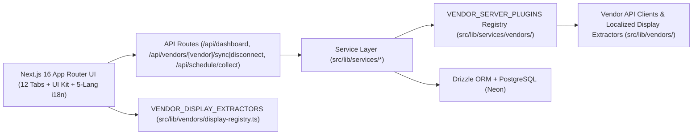

# Home Cockpit

[](https://github.com/matoy/tuya-power-temp/actions/workflows/ci.yml?query=branch%3Amain)
[](https://github.com/matoy/tuya-power-temp/actions/workflows/ci.yml?query=branch%3Adev)
[](LICENSE)
[](#supported-ecosystems)
[](#key-features)
[](docs/AUTH_IDP.md)

[](https://nextjs.org/)
[](https://react.dev/)
[](https://www.typescriptlang.org/)
[](https://orm.drizzle.team/)
[](https://neon.tech/)
[](https://tailwindcss.com/)
[](https://vitest.dev/)
[](#production-deployment-vercel--neon--cron)

**Home Cockpit** is a full-stack multi-vendor smart home monitoring and analytics dashboard built with Next.js 16, Drizzle ORM, and PostgreSQL (Neon). It unifies power metering, indoor climate telemetry, covers, HVAC units, connected appliances, safety detectors, cross-vendor device deduplication, and electricity tariff cost analytics inside a single cockpit.

---

## Key Features

- **12 Dedicated Tabs**:
  - **Overview** — Real-time consumption, indoor temperature & humidity, alerts, connected ecosystems, and top power consumers.
  - **Rooms** — Room-by-room comfort monitoring with configurable min/max temperature and humidity thresholds and cross-vendor room sync.
  - **Energy** — Power consumption history, energy source breakdown (`total_energy` vs integrated `power_w`), and estimated EUR costs.
  - **Climate** — Multi-room temperature and humidity comparison charts and comfort deviation tracking.
  - **Covers** — Unified view of shutters, blinds, awnings, and gates (position %, tilt/orientation, radio protocol, RSSI).
  - **Appliances & HVAC** — Heat pumps, split AC units, and connected household appliances with active programs and remaining time.
  - **Security** — Smoke/CO alarms, water leak sensors, online/offline diagnostics, and battery levels.
  - **Contacts** — Door and window contact sensors with open/closed state tracking.
  - **Automations** — Synced cloud rules and scenes from Tuya Smart.
  - **Tariffs** — French-style **BASE** and **HP/HC** (peak/off-peak) electricity tariff engine with monthly subscription calculation and historical periods.
  - **Systems & Connections** — Unified management hub for all 8 cloud integrations, sync logs, manual device creation, encrypted Gzip JSON backup & restore, and diagnostics.
  - **Setup Guide** — Interactive step-by-step setup wizard with dynamic redirect URIs and copyable configuration snippets.
- **5-Language Internationalization (i18n)**: Automatic browser locale detection + switcher for **English (`en`)**, **Français (`fr`)**, **Español (`es`)**, **Deutsch (`de`)**, and **Italiano (`it`)**, backed by localized vendor status formatters and `Intl` date/number formatting.
- **Identity Provider (IdP / OIDC) & Password Auth**: Built-in OpenID Connect SSO client (Discovery, PKCE `S256`, JWKS `id_token` verification, email/domain allow-listing) compatible with Google, Authentik, Keycloak, Entra ID, and more — usable alone or alongside `APP_PASSWORD` ([`docs/AUTH_IDP.md`](docs/AUTH_IDP.md)).
- **Cross-Vendor Device Linking & Deduplication**: Merge identical physical devices exposed by multiple clouds (e.g., Tuya + Google Home) into a single canonical device while choosing a primary telemetry source and preserving multi-vendor links.
- **Zero-Config Demo Mode**: Works immediately without a database or vendor credentials using an interactive in-memory demo store populated with realistic multi-vendor devices, rooms, and historical telemetry.
- **Encrypted Token Storage & Full Backup**: OAuth/QR tokens stored in PostgreSQL using **AES-256-GCM**, plus Gzip-compressed JSON export/import (`Merge` or `Replace all` modes).

---

## Supported Ecosystems

| Vendor ID (`VendorId`) | Ecosystem | Auth / Protocol | Primary Capabilities |
| :--- | :--- | :--- | :--- |
| `tuya` | **Tuya / Smart Life** | Access ID & Secret (HMAC Cloud API v2) | Power meters, plugs, climate sensors, contact sensors, automations |
| `google_home` | **Google Home / Nest** | OAuth 2.0 (Home MCP JSON-RPC or SDM API) | Thermostats, sensors, room discovery, cross-vendor linking |
| `kasa` | **TP-Link Kasa Cloud** | Email / Password (Kasa Cloud JSON-RPC) | Smart plugs (`KP115` / `HS110`), real-time power & daily energy |
| `home_connect` | **Bosch / Siemens Home Connect** | OAuth 2.0 (Simulator & Production) | Washers, dryers, dishwashers, ovens, active programs, door alerts |
| `somfy` | **Somfy TaHoma / Overkiz** | Email / Password (Overkiz Cloud API) | Shutters, blinds, exterior screens, garage doors, gates |
| `daikin` | **Daikin Onecta** | OAuth 2.0 (PKCE / OAuth Flow) | Air conditioning splits, heat pumps, setpoints, COP / energy stats |
| `xsense` | **X-Sense** | Email / Password (`xsense-api` Cloud) | Smoke, CO, and water-leak alarms, base stations, battery status |
| `xiaomi` | **Xiaomi Home** | Email / Password, 2FA, or QR Login (`MiOT`) | Climate sensors, fans, purifiers, plugs, room sync |
| *Manual* | **Manual Devices** | Built-in UI & API | Custom/offline hardware and standalone room assignment |

---

## Architecture Overview

Home Cockpit is structured around declarative vendor registries (`VENDOR_REGISTRY` and `VENDOR_SERVER_PLUGINS`) so new ecosystems integrate cleanly without wiring boilerplate across every layer:



### Database Schema (`src/db/schema.ts`)

PostgreSQL schema managed with Drizzle ORM (`npm run db:push`):

1. `rooms` — Room definitions with custom icon, color, and comfort target ranges (temperature/humidity min/max).
2. `devices` — Unified physical device inventory, category, network metadata (`ip_address`, `mac_address`), DP config, and latest cached telemetry.
3. `device_vendor_links` — Many-to-one mapping between vendor external IDs (`(vendor, external_id)`) and canonical devices, supporting multi-vendor deduplication.
4. `vendor_connections` — Per-vendor mode, sync status, AES-256-GCM encrypted OAuth/QR tokens, and error state.
5. `metric_readings` — Time-series telemetry (power, voltage, energy, temperature, humidity, contact state, cover position).
6. `tariff_periods` — Electricity pricing contracts (`BASE` or `HP/HC`), time slots, and monthly subscription fees.
7. `collection_logs` — Audit trail for manual and scheduled 30-minute telemetry collection runs.
8. `automations` — Synced cloud rules, triggers, and actions.

---

## Quick Start

### 1. Install dependencies

```bash
npm install
```

### 2. Configure environment variables (optional for Demo Mode)

```bash
cp .env.example .env.local
```

> **Demo Mode:** If `DATABASE_URL` is not set, Home Cockpit automatically boots into an in-memory **Demo Mode** with preloaded multi-vendor rooms, devices, telemetry, and sample connections.

### 3. Push database schema & start dev server

```bash
npm run db:push
npm run dev
```

Open `http://localhost:3000`. Use the **Setup Guide** tab inside the app for interactive vendor-by-vendor configuration snippets and copyable OAuth callback URLs.

---

## Environment Variables Reference

See [`.env.example`](.env.example) for the complete annotated template.

| Group | Variable | Required | Description |
| :--- | :--- | :--- | :--- |
| **Core** | `DATABASE_URL` | For live persistence | PostgreSQL / Neon connection string (omit for Demo Mode) |
| **Core** | `APP_PASSWORD` | Optional if OIDC is used | Password protecting the cockpit login (`hc_session` cookie) |
| **Core** | `AUTH_SESSION_SECRET` | Recommended with OIDC | Secret used to sign `hc_session` & OIDC transactions (falls back to `APP_PASSWORD` if set) |
| **IdP / OIDC** | `AUTH_OIDC_ISSUER`, `AUTH_OIDC_CLIENT_ID`, `AUTH_OIDC_CLIENT_SECRET` | For SSO login | OpenID Connect issuer (e.g. `https://accounts.google.com`) and OAuth client credentials (see [`docs/AUTH_IDP.md`](docs/AUTH_IDP.md)) |
| **IdP / OIDC** | `AUTH_OIDC_PROVIDER_NAME`, `AUTH_ALLOWED_EMAILS`, `AUTH_ALLOWED_DOMAINS`, `AUTH_ALLOW_ANY_AUTHENTICATED` | Strongly recommended | SSO button label (`Google` auto-detected) and fail-closed user authorization policy |
| **Core** | `SCHEDULE_SECRET` | For cron collection | Bearer secret checked by `GET/POST /api/schedule/collect` |
| **Core** | `NEXT_PUBLIC_APP_URL` | Recommended | Public base URL used for OAuth redirect URI generation |
| **Core** | `TOKEN_ENCRYPTION_KEY` | Optional (Recommended) | 64-char hex AES-256-GCM key for encrypting tokens in `vendor_connections` |
| **Tuya** | `TUYA_ACCESS_ID`, `TUYA_ACCESS_SECRET` | For Tuya | Tuya Cloud IoT project credentials |
| **Tuya** | `TUYA_ENDPOINT`, `TUYA_USER_UID` | For Tuya | Regional datacenter URL (e.g. `https://openapi.tuyaeu.com`) and linked app UID |
| **Google Home** | `GOOGLE_CLIENT_ID`, `GOOGLE_CLIENT_SECRET` | For Google Home | Google Cloud OAuth 2.0 credentials |
| **Google Home** | `GOOGLE_HOME_MODE` | Optional | `mcp` (default), `sdm`, or `off` |
| **Google Home** | `GOOGLE_SDM_PROJECT_ID`, `GOOGLE_REDIRECT_URI` | For SDM / custom callback | Device Access UUID (`sdm`) and optional OAuth callback override |
| **Kasa** | `KASA_EMAIL`, `KASA_PASSWORD`, `KASA_REGION` | For TP-Link Kasa | Kasa Cloud credentials and region (`eu`, `us`, `ap`, `global`) |
| **Home Connect** | `SIEMENS_HOME_CONNECT_CLIENT_ID`, `SIEMENS_HOME_CONNECT_CLIENT_SECRET` | For Home Connect | Bosch/Siemens Home Connect OAuth credentials |
| **Home Connect** | `SIEMENS_HOME_CONNECT_ENV`, `SIEMENS_HOME_CONNECT_REDIRECT_URI` | Optional | `live` or `sim` (simulator), plus optional callback URL override |
| **Somfy** | `SOMFY_EMAIL`, `SOMFY_PASSWORD`, `SOMFY_REGION` | For Somfy Overkiz | Account credentials and region (`eu`, `na`, `oc`) |
| **Somfy** | `SOMFY_CLOUD_URL`, `SOMFY_GATEWAY_IP`, `SOMFY_GATEWAY_MAC` | Optional | Overkiz API URL and local gateway fallback metadata |
| **Daikin** | `DAIKIN_CLIENT_ID`, `DAIKIN_CLIENT_SECRET`, `DAIKIN_REDIRECT_URI` | For Daikin Onecta | Daikin Developer Portal OAuth credentials |
| **X-Sense** | `XSENSE_EMAIL`, `XSENSE_PASSWORD` | For X-Sense | Dedicated secondary shared-account credentials |
| **Xiaomi** | `XIAOMI_USERNAME`, `XIAOMI_PASSWORD`, `XIAOMI_REGION` | Optional (`env` auth) | Xiaomi account fallback (`de`, `cn`, `us`, `sg`, `ru`, `i2`); interactive 2FA/QR also supported in UI |

---

## Production Deployment (Vercel + Neon + Cron)

1. Provision a serverless PostgreSQL database on **Neon** and set `DATABASE_URL`.
2. Deploy the Next.js application to **Vercel** and configure the environment variables above in your Vercel Project Settings.
3. Run `npm run db:push` once against your production database.
4. Configure a free scheduled job (e.g. on **cron-job.org**) every **30 minutes** (`*/30 * * * *`):
   - **URL:** `https://<your-domain>/api/schedule/collect`
   - **Method:** `GET` or `POST`
   - **Header:** `Authorization: Bearer <YOUR_SCHEDULE_SECRET>`

### Branching & CI/CD Workflow

- Active development happens on the **`dev`** branch (Vercel preview deployments on `dev` are disabled via `vercel.json`).
- Pushing to `dev` automatically runs the GitHub Actions `quality-and-build` job (`typecheck`, `lint`, `npm test`, `npm run build`).
- When all checks pass on `dev`, `promote-to-main` automatically syncs `dev` into `main`, which triggers the production deployment on **Vercel** (set a `PROMOTE_TOKEN` secret if branch protection on `main` blocks `GITHUB_TOKEN`).

---

## Available Scripts

| Command | Description |
| :--- | :--- |
| `npm run dev` | Start Next.js development server |
| `npm run build` | Build production bundle (`next build`) |
| `npm run start` | Run production server |
| `npm run lint` | Run ESLint 9 (`eslint .`) |
| `npm run typecheck` | Run TypeScript compiler check (`tsc --noEmit`) |
| `npm test` | Run automated Vitest test suite (`vitest run`) |
| `npm run test:coverage` | Run Vitest with V8 code coverage report |
| `npm run test:watch` | Run Vitest in interactive watch mode |
| `npm run db:push` | Push Drizzle schema directly to PostgreSQL |
| `npm run db:generate` | Generate Drizzle SQL migrations |
| `npm run db:studio` | Launch Drizzle Studio visual database explorer |

---

## Contributing

Want to add support for a new smart home ecosystem or integrate another vendor protocol?

Read the **[Vendor Contribution Guide](docs/ADDING_A_VENDOR.md)** to see how **Home Cockpit** uses `VENDOR_REGISTRY`, `VENDOR_SERVER_PLUGINS`, and `VENDOR_DISPLAY_EXTRACTORS` so new vendors automatically inherit unified device sync, dynamic `/api/vendors/[vendor]/{sync,disconnect}` endpoints, 30-minute telemetry collection, cross-vendor deduplication, room sync, and 5-language UI rendering.
